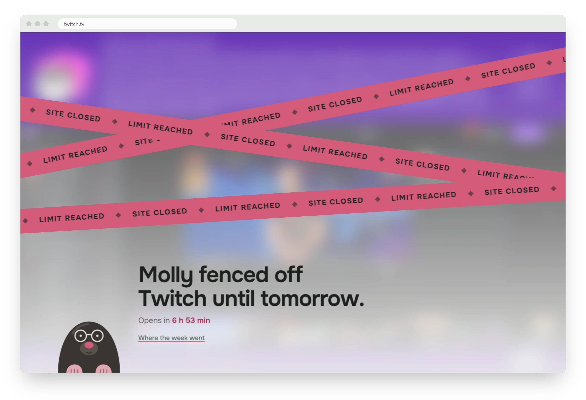
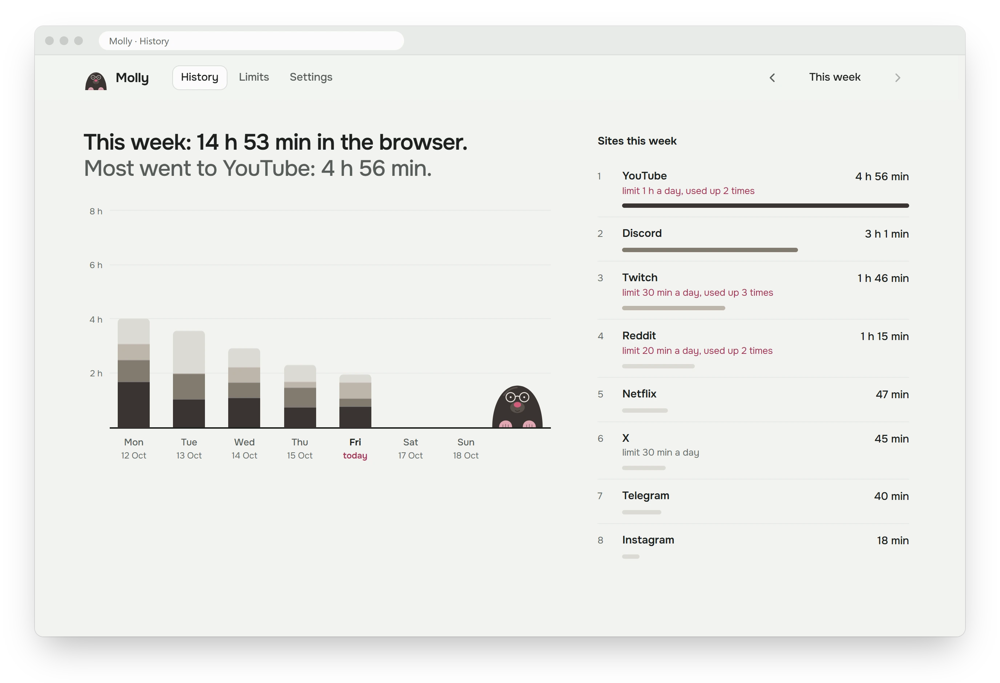
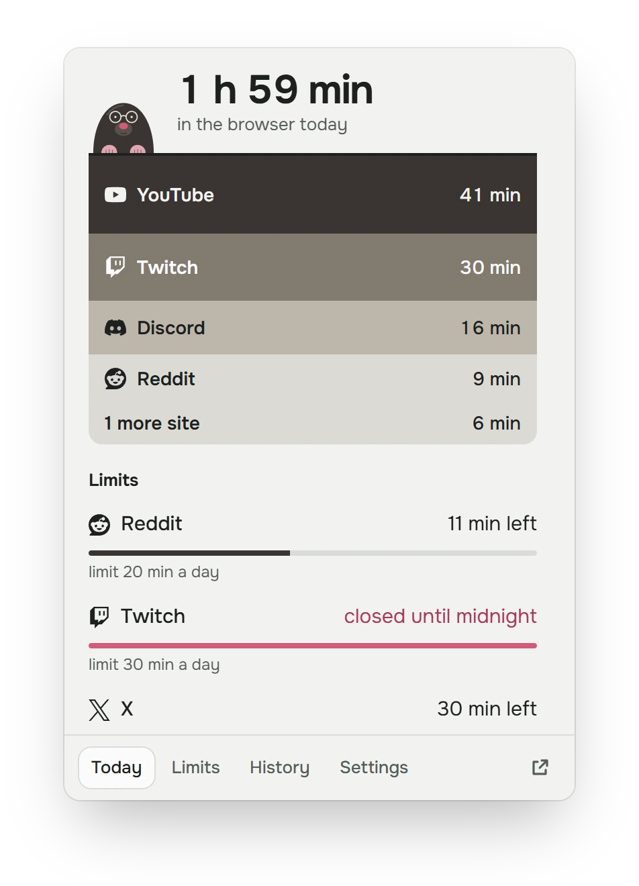
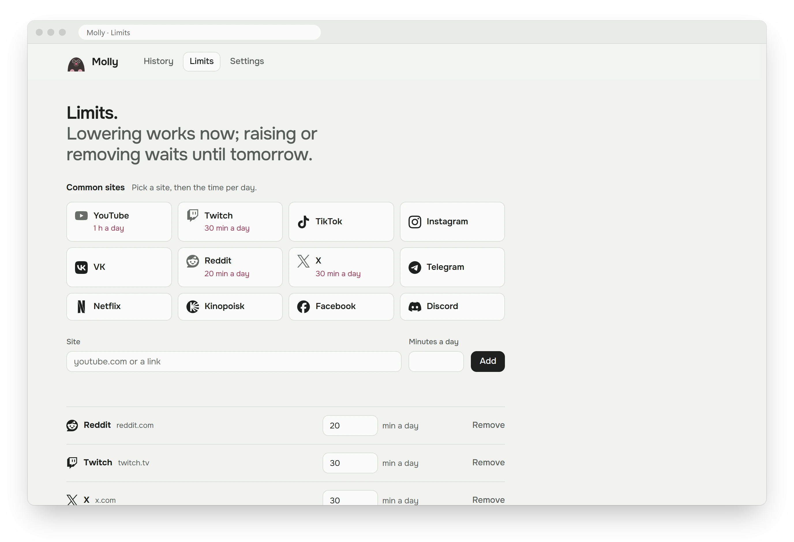

<p align="center">
  
</p>
<h1 align="center">Molly</h1>
<p align="center">
  A Chrome extension that counts your time on each site and fences it off when the daily limit runs out.
</p>
<p align="center">
  <a href="https://github.com/vibecodoor/molly/releases/latest"><b>Download</b></a> ·
  <a href="#install">Install</a> ·
  <a href="#how-it-counts">How it counts</a>
</p>
<p align="center">
  <a href="https://github.com/vibecodoor/molly/releases/latest"></a>
  
  <a href="LICENSE"></a>
</p>



When a site's limit runs out, Molly doesn't swap the page for a dull "blocked" screen. The site stays loaded but sits behind frosted glass and barrier tape, sound and video pause, and a countdown shows when it opens again. There is no "just five more minutes" button.

- **Honest numbers.** A site counts while it's the tab you're looking at in the focused Chrome window, or while it plays sound (a stream in the background counts). A tab left open and silent doesn't.
- **Limits that stick.** Lowering a limit works right away. Raising or removing one waits until tomorrow, so you can't negotiate with yourself mid-video.
- **A week at a glance.** Daily bars, a ranked list of sites, how often each limit ran out, plus CSV export and JSON backups.
- **Private by design.** No account, no servers, no analytics. Everything stays in `chrome.storage` on your machine.

### History: where the week went



### The popup: today so far and what's left

<p align="center">
  
</p>

### Limits: 12 one-click presets, or any site



There's a dark theme too: it follows your system, or pick one in Settings. The interface is in English and Russian.

## Install

Molly isn't on the Chrome Web Store, so you install it from a release zip. It takes about a minute.

### With an AI agent

Paste this into Claude Code, Codex, Hermes or any agent that can run commands on your computer:

```text
Install the Molly Chrome extension from https://github.com/vibecodoor/molly.
1. Download the molly-*-chrome.zip asset of the latest release
   (https://api.github.com/repos/vibecodoor/molly/releases/latest).
2. Extract it into a permanent folder: ~/Extensions/molly
   (Windows: %USERPROFILE%\Extensions\molly). If Molly is already there,
   overwrite its files in place. Never delete the folder: Chrome loads from it.
3. Check that manifest.json sits directly in that folder.
4. Open chrome://extensions and tell me the clicks: turn on Developer mode,
   Load unpacked, pick that folder. If it's an update, click the reload icon
   on Molly's card instead.
```

The agent does the download and unpacking. The last two clicks are yours: Chrome doesn't let programs install an unpacked extension on their own.

### By hand

1. Download `molly-<version>-chrome.zip` from the [latest release](https://github.com/vibecodoor/molly/releases/latest).
2. **Extract it** to a folder you'll keep, for example `Documents\Molly`. Chrome loads the extension from this folder every time it starts, so don't delete or move it.
3. Open `chrome://extensions`.
4. Turn on **Developer mode** (top-right corner).
5. Click **Load unpacked** and select the extracted folder (the one with `manifest.json` directly inside).
6. Click the puzzle icon in the toolbar and pin Molly.

Works in Chromium-based browsers too: Edge (`edge://extensions`, Developer mode is in the left sidebar), Brave (`brave://extensions`) and others.

> [!IMPORTANT]
> Chrome may ask you to "Disable developer mode extensions" when it starts. Close the prompt instead of clicking Disable, or Molly stops counting until you turn it back on.

### Update

1. Download the new zip and extract it **over the same folder**, replacing the files.
2. On `chrome://extensions`, click the reload icon on Molly's card.

Your history and limits stay. Don't click **Remove**: removing the extension deletes its data. If you ever need to, save a backup first (Settings → **Save backup**) and restore it afterwards.

<details>
<summary><b>Troubleshooting</b></summary>

- **"Manifest file is missing or unreadable".** You picked the zip or the wrong folder. Extract the zip and select the folder that has `manifest.json` directly inside.
- **Molly disappeared or shows an error after a while.** The folder was moved or deleted. Put it back, or extract the zip again and load it.
- **Molly is turned off after a Chrome restart.** You clicked Disable on the developer-mode prompt. Turn it back on in `chrome://extensions`.
- **Time isn't counted in Incognito.** Open Molly's card → Details → turn on **Allow in Incognito**.
- **Dragging the zip onto the extensions page does nothing.** That's expected. Extract it and use Load unpacked.

</details>

## How it counts

- A site counts while its tab is the active tab of the focused Chrome window. When another app is in front, it stops.
- A tab playing sound counts anywhere: a background tab, another window, a minimized window. A muted video doesn't.
- After 5 minutes with no mouse or keyboard input, only tabs with sound keep counting.
- One site open in several tabs counts once. Counting pauses while the screen is locked. A sleeping laptop adds no time.
- A limit covers subdomains and the same name on other domains: limiting `youtube.com` also covers `m.youtube.com` and `youtube.de`.
- Days run from local midnight to midnight. That's when blocks lift and pending limit raises take effect.
- No time is counted on a site while it's blocked.

> [!NOTE]
> Molly makes no network requests. The font and icons are bundled, and blocked sites only load their own page under the overlay. The only way past a block is to turn off the extension, and that's by design.

## License

[MIT](LICENSE). Brand icons come from [Simple Icons](https://simpleicons.org) (CC0).
